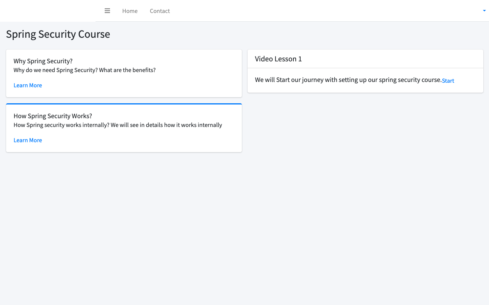
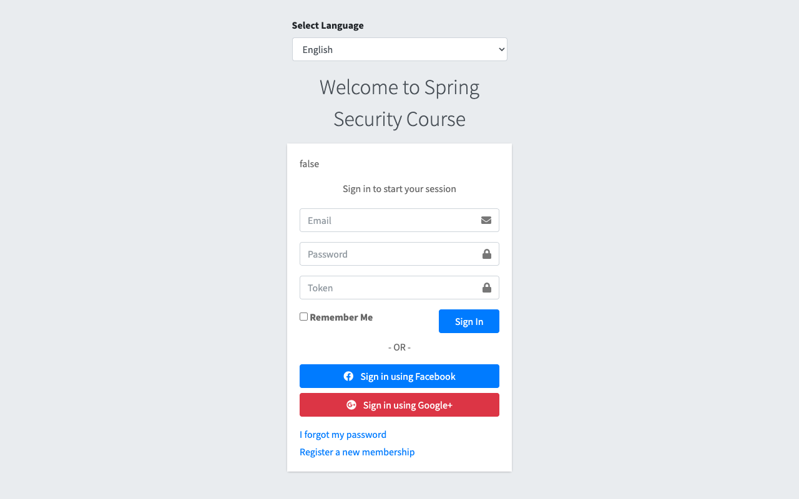
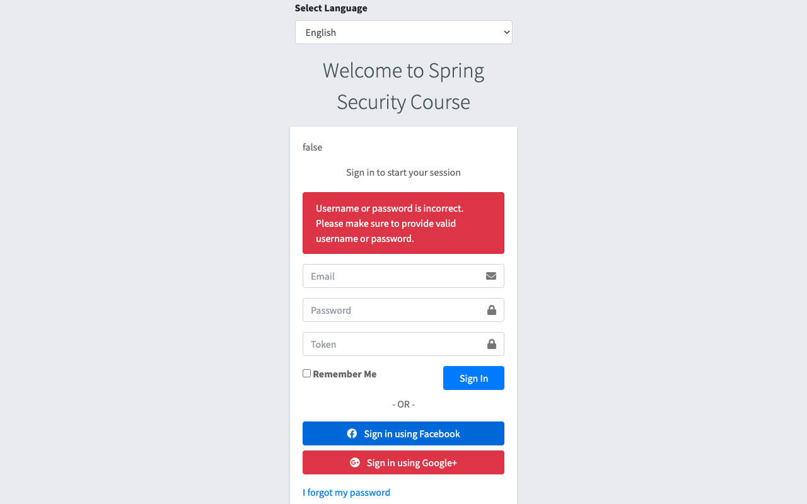
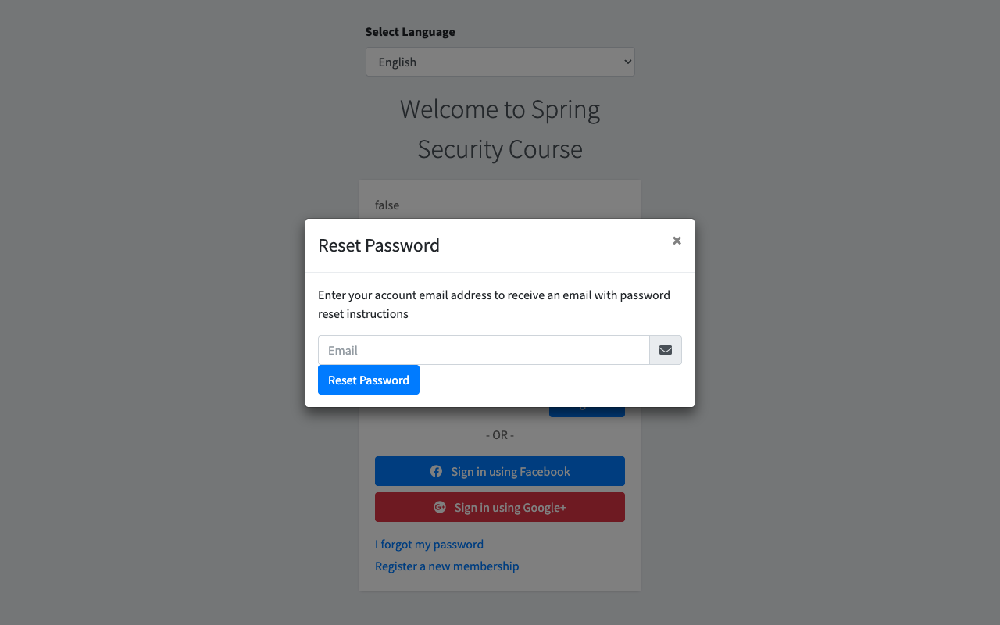
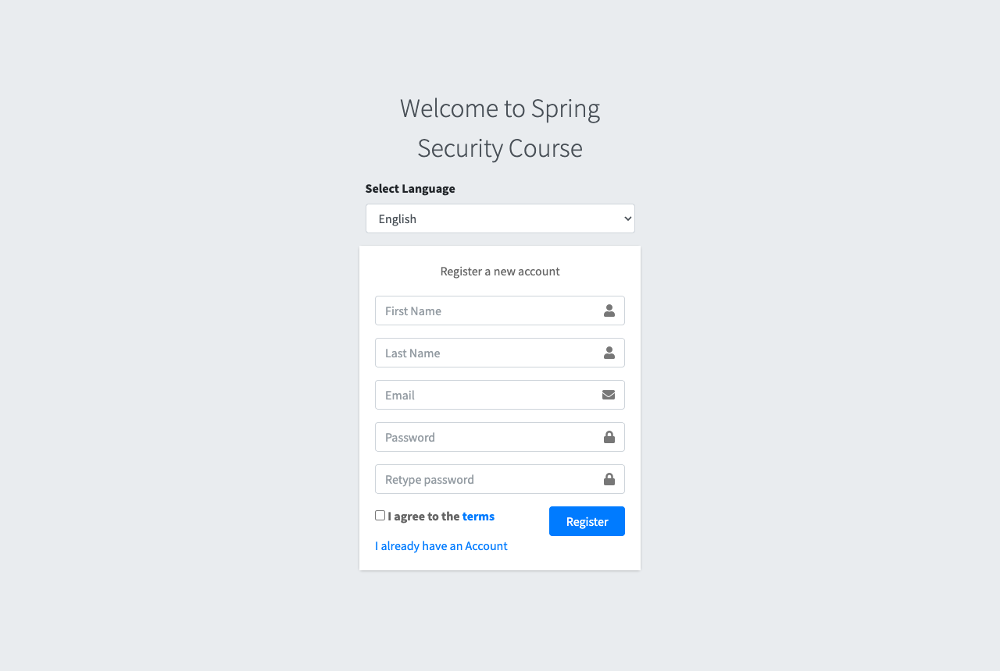
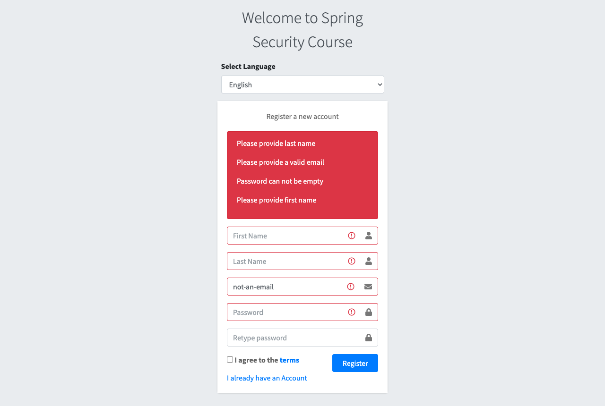
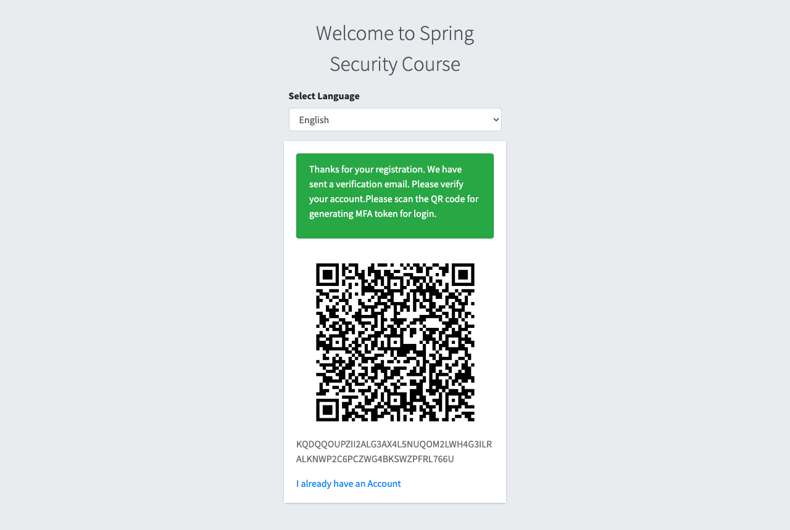
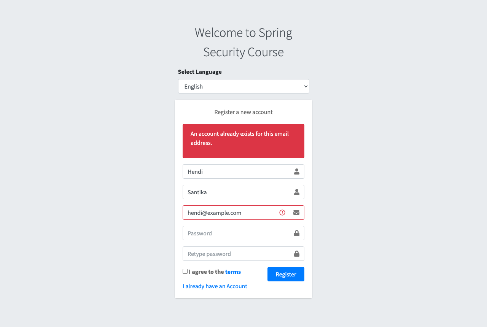
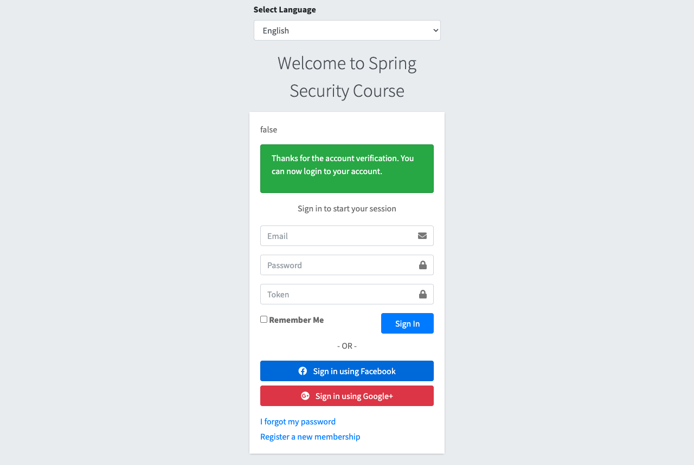

# User Management Web App

[](https://github.com/hendisantika/user-management-web-app/actions/workflows/maven.yml)


A comprehensive Spring Boot 4.1.2 application for user management with advanced security features including Multi-Factor
Authentication (MFA), brute force protection, and session management.

## Features

- User Registration and Authentication
- Multi-Factor Authentication (MFA) using TOTP
- Email Verification
- Password Reset Functionality
- Brute Force Attack Protection
- Session Management with Redis
- Remember Me Functionality
- HTTPS/HTTP Support
- LDAP Integration Support
- Role-Based Access Control (RBAC)

## Screenshots

| Home | Login (with MFA token) |
|------|------------------------|
|  |  |

| Login Error | Forgot Password |
|-------------|-----------------|
|  |  |

| Register | Register Validation |
|----------|---------------------|
|  |  |

| Registration Success (MFA QR Code) | Duplicate Email |
|------------------------------------|-----------------|
|  |  |

| Account Verified |
|------------------|
|  |

## Technology Stack

- **Java 25** (LTS)
- **Spring Boot 4.1.2** (Spring Framework 7)
    - Spring Security 7
    - Spring Data JPA
    - Spring Session with Redis
    - Spring Mail
    - Thymeleaf
- **MySQL** - Primary database
- **Redis** - Session storage
- **Lombok** - Code generation
- **Maven 3.10** (via Maven Wrapper) - Build tool
- **Docker** - Containerization (optional)
- **Testcontainers** - Docker-based integration testing
- **Spring Boot Docker Compose** - Automatic Docker Compose lifecycle management

## Quick Start with Docker (Recommended)

The easiest way to run the application is using Docker Compose, which automatically sets up MySQL 9.5.0, Redis, and the
Spring Boot application.

### Prerequisites for Docker

- **Docker Desktop** or Docker Engine with Docker Compose
  ```bash
  docker --version
  docker compose version
  ```

### Running with Docker

1. **Clone the repository** (if not already done)

2. **Start all services**
   ```bash
   docker compose up -d
   ```

   This command will:
    - Pull MySQL 9.5.0, Redis 7, and build the Spring Boot application
    - Create a dedicated Docker network for the services
    - Start MySQL on port 3307 (to avoid conflicts with local MySQL)
    - Start Redis on port 6379
    - Start the application on ports 8080 (HTTP) and 8443 (HTTPS)
    - Create persistent volume for MySQL data

3. **Check container status**
   ```bash
   docker compose ps
   ```

4. **View logs**
   ```bash
   # All services
   docker compose logs -f

   # Specific service
   docker compose logs -f app
   docker compose logs -f mysql
   docker compose logs -f redis
   ```

5. **Access the application**
    - HTTPS: https://localhost:8443
    - HTTP: http://localhost:8080 (redirects to HTTPS)

### Docker Configuration

The Docker setup includes:

- **MySQL 9.5.0**
    - Port: 3307 (external) → 3306 (internal)
    - Database: `user_management`
    - Username: `yu71`
    - Password: `53cret`
    - Root password: `53cret`
    - Persistent volume: `mysql-data`

- **Redis 7**
    - Port: 6379
    - Used for session management

- **Spring Boot App**
    - HTTP Port: 8080
    - HTTPS Port: 8443
    - Auto-configured to connect to MySQL and Redis
    - Health check enabled

### Useful Docker Commands

```bash
# Stop all services
docker compose down

# Stop and remove volumes (clean slate)
docker compose down -v

# Rebuild and restart
docker compose up -d --build

# View real-time logs
docker compose logs -f app

# Execute commands in MySQL container
docker exec -it user-management-mysql mysql -uyu71 -p53cret user_management

# Execute commands in Redis container
docker exec -it user-management-redis redis-cli

# Access Spring Boot container shell
docker exec -it user-management-app sh

# Check MySQL database and tables
docker exec user-management-mysql mysql -uyu71 -p53cret -e "USE user_management; SHOW TABLES;"
```

### Docker Files

The Docker setup consists of:

- `Dockerfile` - Multi-stage build for the Spring Boot application
- `docker-compose.yml` - Orchestrates MySQL, Redis, and the application
- `.dockerignore` - Excludes unnecessary files from Docker build
- `src/main/resources/application-docker.properties` - Docker-specific configuration

## Prerequisites (Local Development without Docker)

Before running the application, ensure you have the following installed:

1. **Java Development Kit (JDK) 25 or higher**
   ```bash
   java -version
   ```

2. **MySQL Server 8.0+**
   ```bash
   mysql --version
   ```

3. **Redis Server**
   ```bash
   redis-server --version
   ```

4. **Maven 3.9+** (or use the included Maven Wrapper, which uses Maven 3.10.0)
   ```bash
   ./mvnw --version
   ```

## Database Setup

1. **Start MySQL Server**

2. **Create Database** (Optional - the application will create it automatically)
   ```sql
   CREATE DATABASE user_management;
   ```

3. **Update Database Configuration**

   Edit `src/main/resources/application.properties`:
   ```properties
   spring.datasource.url=jdbc:mysql://localhost:3306/user_management?createDatabaseIfNotExist=true&useUnicode=true&useJDBCCompliantTimezoneShift=true&useLegacyDatetimeCode=false&serverTimezone=Asia/Jakarta&useSSL=false&allowPublicKeyRetrieval=true
   spring.datasource.username=root
   spring.datasource.password=your_password
   ```

## Redis Setup

1. **Start Redis Server**
   ```bash
   redis-server
   ```

   Or on macOS with Homebrew:
   ```bash
   brew services start redis
   ```

2. **Verify Redis Configuration**

   In `src/main/resources/application.properties`:
   ```properties
   spring.redis.host=localhost
   spring.redis.port=6379
   ```

## Email Configuration

Update the SMTP settings in `src/main/resources/application.properties`:

```properties
spring.mail.host=smtp.gmail.com
spring.mail.port=587
spring.mail.username=your-email@gmail.com
spring.mail.password=your-app-password
spring.mail.properties.mail.smtp.auth=true
spring.mail.properties.mail.smtp.starttls.enable=true
```

**Note:** For Gmail, you need to use an App Password instead of your regular password.

## SSL Configuration

The application is configured to run on both HTTP (8080) and HTTPS (8443).

The SSL keystore is located at `src/main/resources/hendisantika.p12`

Configuration in `application.properties`:

```properties
server.ssl.key-store-type=PKCS12
server.ssl.key-store=classpath:hendisantika.p12
server.ssl.key-store-password=123456
server.ssl.key-alias=hendisantika
server.port=8443
http.port=8080
```

### Generating Your Own SSL Certificate

To generate a new SSL certificate:

```bash
keytool -genkeypair -alias hendisantika -keyalg RSA -keysize 2048 \
  -storetype PKCS12 -keystore hendisantika.p12 -validity 3650 \
  -storepass 123456 \
  -dname "CN=localhost, OU=Development, O=YourOrg, L=YourCity, ST=YourState, C=YourCountry"
```

Then move the generated file to `src/main/resources/`.

## Building the Application

### Using Maven Wrapper (Recommended)

```bash
./mvnw clean package
```

### Using System Maven

```bash
mvn clean package
```

The build will:

- Compile all Java sources
- Process Lombok annotations
- Run tests (use `-DskipTests` to skip)
- Package the application as a JAR file

## Running the Application

### Method 1: Using Maven Spring Boot Plugin

```bash
./mvnw spring-boot:run
```

### Method 2: Using Java JAR

```bash
java -jar target/user-management-web-app-0.0.1-SNAPSHOT.jar
```

### Method 3: From Your IDE

Run the main class: `com.hendisantika.UserManagementWebAppApplication`

## Accessing the Application

Once started, the application will be available at:

- **HTTPS:** https://localhost:8443
- **HTTP:** http://localhost:8080 (redirects to HTTPS)

### Default Pages

- **Home:** https://localhost:8443/home
- **Login:** https://localhost:8443/login
- **Register:** https://localhost:8443/register
- **Account Management:** https://localhost:8443/account/home (requires authentication)

## Application Configuration

Key configuration properties in `application.properties`:

### Security Settings

```properties
# Brute force protection
jdj.security.failedlogin.count=2
jdj.brute.force.cache.max=1000
# Secure token validity (in seconds) - 8 hours
jdj.secure.token.validity=28800
```

### Session Management

```properties
# Session namespace
spring.session.redis.namespace=spring:session
# Session timeout
server.servlet.session.timeout=30m
```

### Base URLs

```properties
site.base.url.http=http://localhost:8080
site.base.url.https=https://localhost:8443
```

## User Roles

The application supports the following roles:

- **CUSTOMER** - Standard user with access to account management
- **ADMIN** - Administrator with full access to all features

## Security Features

### 1. Multi-Factor Authentication (MFA)

- TOTP-based authentication
- QR code generation for authenticator apps
- Secret key management

### 2. Brute Force Protection

- Failed login attempt tracking
- Automatic account locking after configured attempts
- IP-based tracking

### 3. Password Security

- BCrypt password encoding
- Password reset via email
- Secure token-based verification

### 4. Session Management

- Redis-backed session storage
- Session fixation protection
- Remember-me functionality
- Concurrent session control

## Development

### Project Structure

```
src/main/java/com/hendisantika/
├── config/                    # Application configuration
├── core/
│   ├── email/                # Email services and templates
│   ├── exception/            # Custom exceptions
│   ├── security/             # Security configuration and handlers
│   │   ├── authentication/   # Custom authentication providers
│   │   ├── bruteforce/       # Brute force protection
│   │   ├── filter/           # Security filters
│   │   ├── handlers/         # Success/failure handlers
│   │   ├── mfa/             # Multi-factor authentication
│   │   └── token/           # Token management
│   ├── service/             # Business logic services
│   └── user/                # User entities and repositories
└── web/
    ├── controller/          # MVC controllers
    └── data/                # DTOs and form objects
```

### Testing

Run tests with:

```bash
./mvnw test
```

> **Note:** `UserManagementWebAppApplicationTests#contextLoads` boots the full Spring context, so MySQL
> (`localhost:3306`, `root`/`root`) and Redis (`localhost:6379`) must be running. Quick way to start them:
>
> ```bash
> docker run -d --rm --name ci-mysql -e MYSQL_ROOT_PASSWORD=root -e MYSQL_DATABASE=user_management -p 3306:3306 mysql:9.5.0
> docker run -d --rm --name ci-redis -p 6379:6379 redis:8-alpine
> ```

#### Integration Testing with Testcontainers

The project includes Testcontainers support for Docker-based integration testing with MySQL 9.5.0:

```bash
# Run integration tests with Testcontainers
./mvnw test -Dtest=MySQLContainerTest

# Run all tests including integration tests
./mvnw verify
```

**Sample Integration Test** (Testcontainers 2.x + `@ServiceConnection`, skipped when Docker is not available):
```java
@SpringBootTest
@Testcontainers(disabledWithoutDocker = true)
class MySQLContainerTest {
    @Container
    @ServiceConnection
    static MySQLContainer mysql = new MySQLContainer(DockerImageName.parse("mysql:9.5.0"))
            .withDatabaseName("testdb")
            .withUsername("testuser")
            .withPassword("testpass");

    @Container
    @ServiceConnection(name = "redis")
    static GenericContainer<?> redis = new GenericContainer<>(DockerImageName.parse("redis:8-alpine"))
            .withExposedPorts(6379);
}
```

See [`DOCKER_LIBRARIES.md`](DOCKER_LIBRARIES.md) for details on the Docker-related libraries.

#### Spring Boot Docker Compose Support

When running locally, Spring Boot can automatically manage your Docker Compose lifecycle:

1. **Enable Docker Compose support** in `application-docker.properties`:
   ```properties
   spring.docker.compose.enabled=true
   spring.docker.compose.file=docker-compose.yml
   spring.docker.compose.lifecycle-management=start_and_stop
   ```

2. **Run the application** - Docker Compose will start automatically:
   ```bash
   ./mvnw spring-boot:run -Dspring-boot.run.profiles=docker
   ```

3. **Stop the application** - Docker Compose will stop automatically

## Continuous Integration

GitHub Actions workflow [`.github/workflows/maven.yml`](.github/workflows/maven.yml) runs on every push and pull request to `main`:

1. Starts **MySQL 9.5.0** and **Redis 8** as service containers
2. Sets up **Temurin JDK 25** with Maven dependency caching
3. Builds and tests the project with `./mvnw -B package`
4. On push to `main`, submits the Maven dependency graph to GitHub for better Dependabot alerts

## Dependency Updates (Dependabot)

[`.github/dependabot.yml`](.github/dependabot.yml) keeps dependencies up to date automatically:

| Ecosystem        | Schedule (Asia/Jakarta)  | Notes                                                                                     |
|------------------|--------------------------|-------------------------------------------------------------------------------------------|
| `maven`          | Daily, 21:00             | Grouped: Spring (minor/patch), Testcontainers, Apache Commons, Maven build, other minor/patch |
| `github-actions` | Weekly (Monday), 21:00   | All actions grouped in a single PR                                                        |
| `docker`         | Weekly (Monday), 21:00   | `Dockerfile` base images; major `eclipse-temurin` bumps ignored to stay on JDK 25 LTS      |
| `docker-compose` | Weekly (Monday), 21:00   | Images in `docker-compose.yml`                                                            |

PRs are labelled (`dependencies`, `java`, `github-actions`, `docker`) and use conventional commit prefixes
(`chore(deps)`, `ci(deps)`, `chore(docker)`).

## Troubleshooting

### Common Issues

1. **MySQL Connection Error: "Public Key Retrieval is not allowed"**

   Add `allowPublicKeyRetrieval=true` to your database URL:
   ```properties
   spring.datasource.url=jdbc:mysql://localhost:3306/user_management?allowPublicKeyRetrieval=true
   ```

2. **Redis Connection Error**

   Ensure Redis is running:
   ```bash
   redis-cli ping
   # Should return: PONG
   ```

3. **SSL Certificate Error**

   If using a self-signed certificate, your browser will show a warning.
   For development, you can accept the warning and proceed.

4. **Port Already in Use**

   Change the ports in `application.properties`:
   ```properties
   server.port=9443  # HTTPS port
   http.port=9080    # HTTP port
   ```

5. **Email Not Sending**

    - Verify SMTP credentials
    - For Gmail, ensure "Less secure app access" is enabled or use an App Password
    - Check firewall settings for port 587

### Docker-Specific Issues

6. **Docker Container Won't Start**

   Check container logs:
   ```bash
   docker compose logs app
   ```

7. **MySQL Port Conflict**

   If port 3306 is already in use, the docker-compose.yml is configured to use port 3307 externally.

8. **Container Health Check Failing**

   Wait for MySQL to be fully initialized (can take 30-60 seconds on first run):
   ```bash
   docker compose ps
   # Check STATUS column for "healthy"
   ```

9. **Reset Docker Environment**

   For a clean start:
   ```bash
   docker compose down -v
   docker compose up -d --build
   ```

10. **Access MySQL in Docker**

    ```bash
    docker exec -it user-management-mysql mysql -uyu71 -p53cret user_management
    ```

## Actuator Endpoints

Spring Boot Actuator is enabled with all endpoints exposed:

- **Health:** https://localhost:8443/actuator/health
- **Info:** https://localhost:8443/actuator/info
- **Metrics:** https://localhost:8443/actuator/metrics

## Contributing

1. Fork the repository
2. Create a feature branch
3. Commit your changes
4. Push to the branch
5. Create a Pull Request

## License

This project is open source and available for educational purposes.

## Author

**Hendi Santika**

- Email: hendisantika@gmail.com
- Telegram: @hendisantika34

## Version History

- **0.0.1-SNAPSHOT** - Current development version
    - Upgraded to **JDK 25** (pom, Dockerfile & GitHub Actions)
    - Upgraded to **Spring Boot 4.1.2** / Spring Security 7 (migrated removed APIs)
    - GitHub Actions CI with MySQL & Redis service containers
    - Enhanced Dependabot (Maven, GitHub Actions, Docker, Docker Compose with grouping)
    - Updated to Spring Boot 3.5.7
    - Migrated from Java EE (javax.*) to Jakarta EE
    - Updated Spring Security configuration to version 6
    - Fixed Lombok annotation processing
    - Added Docker support with Docker Compose
    - MySQL 9.5.0 integration with custom credentials (user: yu71, password: 53cret)
    - Multi-stage Dockerfile for optimized image size
    - Health checks for all services
    - Persistent MySQL data volumes
    - Spring Boot Docker Compose support for automatic lifecycle management
    - Testcontainers integration for Docker-based testing
    - Cloud Native Buildpacks support for building Docker images
    - Added comprehensive documentation

## Support

For issues and questions, please create an issue in the project repository.
